# Inference Gateway


A high-throughput inference service that respects **per-model RPM (requests/minute) and TPM
(tokens/minute) provider limits that can change while it runs**. It ships with a provider
simulator, an asynchronous batch API with completion callbacks, a load generator that produces
PASS/FAIL reports, a multi-process benchmark, and a live React dashboard.

The starting point was a synchronous loop that managed ~600 requests/minute. Against a provider
offering 50,000 RPM / 100M TPM, this system uses ~96% of the allowed capacity without ever
exceeding it in any 60-second window.

## Results at a glance

All numbers below are **measured** on an Apple M4 (10 cores, 16 GB), macOS 26.6, Python 3.13.4,
PostgreSQL 16.15, Redis 7.4.11. Projections are kept separate, in [Scaling to 10B requests/min](#scaling-to-10b-requestsmin).

| Goal | Result |
|---|---|
| Scenario 1 — reach provider capacity (50k RPM / 100M TPM) | ✅ **48,217 completed/min = 96.4%** of the limit after warm-up; max 49,000 requests in any real 60 s; 0 provider 429s |
| Scenario 2 — two models, limit cut and restored live | ✅ A held to **4,840/min** while cut to 5k, back to 28,910 within 75 s of restore; B steady at 19,205/min; no restart |
| Scenario 3 — async batch + callback | ✅ ack in **301 ms**; callback delivered on attempt 3 after two rejections; 10,000 unique ids |
| Required benchmark — 300,000 completions/s | ✅ **400,030/s** sustained (400k offered) |
| Stretch benchmark — 1,000,000 completions/s | ✅ **1,177,564/s** sustained (1.2M offered) |

**Share of the configured limit actually used** (pass bar: 90%)

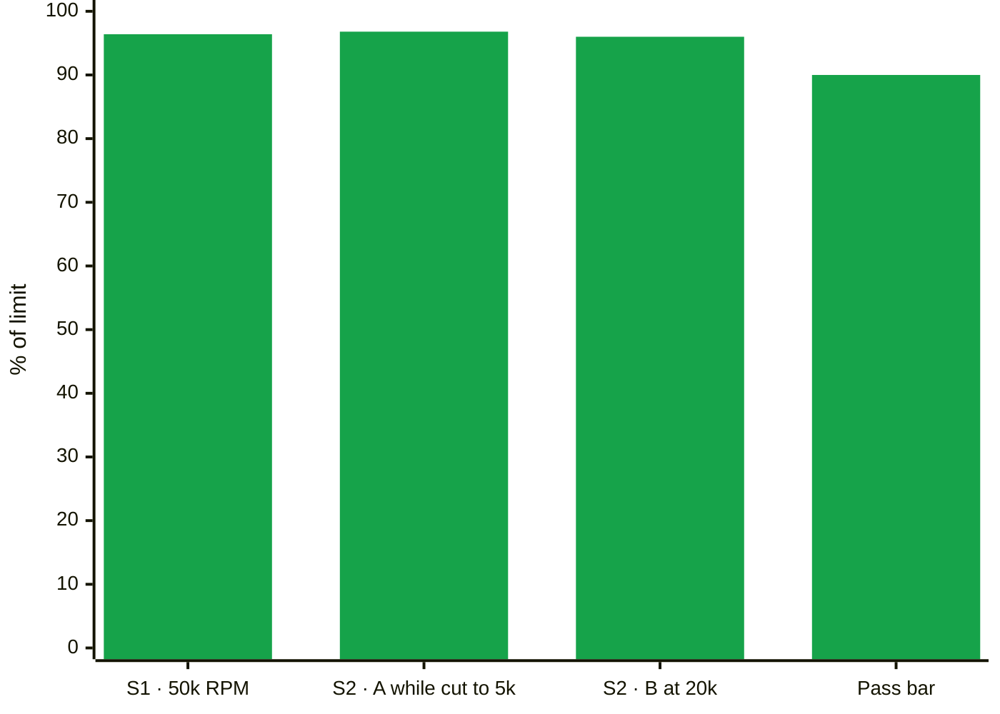

**Benchmarks: sustained completions per second vs target**

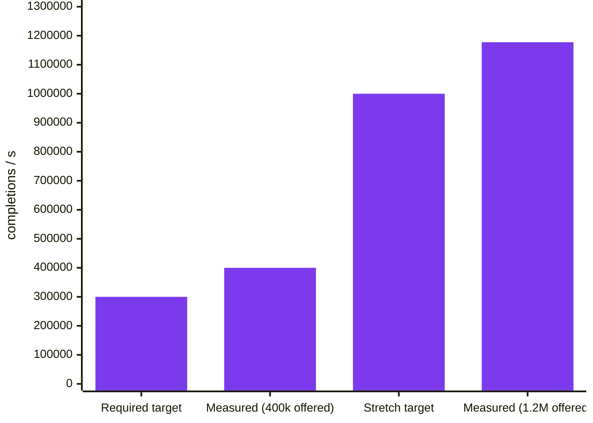

---

## Contents

- [Architecture](#architecture)
- [Quick start](#quick-start)
- [Running the components](#running-the-components)
- [Configuring models and changing limits](#configuring-models-and-changing-limits)
- [Load generator](#load-generator)
- [Validation scenarios](#validation-scenarios)
- [Benchmarks](#benchmarks)
- [API reference](#api-reference)
- [Design decisions and tradeoffs](#design-decisions-and-tradeoffs)
- [Known limitations](#known-limitations)
- [Scaling to 10B requests/min](#scaling-to-10b-requestsmin)
- [Testing](#testing)
- [Project layout](#project-layout)
- [AI usage](#ai-usage)

---

## Architecture

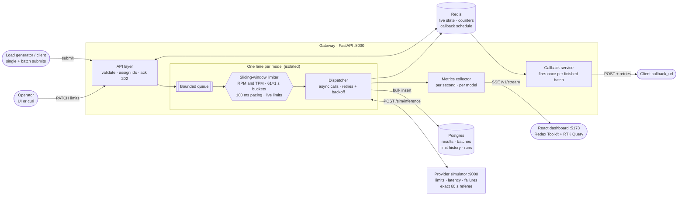

### Request lifecycle

Every request is in exactly one of eight states, and illegal transitions raise an error
(`backend/common/states.py`):

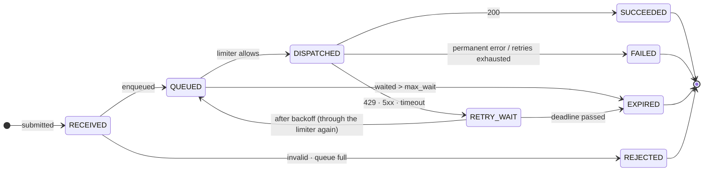

The accounting rule is checked at the end of every run:
**submitted = completed (SUCCEEDED + FAILED) + waiting + expired + rejected.**

### How the scheduler decides, for the request at the head of each model's queue

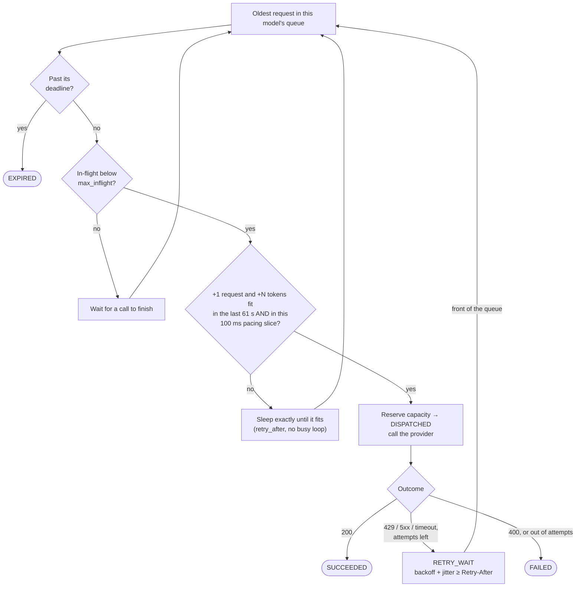

### Behaviour when demand exceeds capacity

| Situation | What happens | Client sees |
|---|---|---|
| More demand than the limit allows | Request waits in its model's queue and is paced out by the limiter | `202`, later a final state |
| Model's queue is full (`max_queue`) | `REJECTED` immediately (backpressure) | `429` |
| Waited longer than `max_wait_seconds` | `EXPIRED`, counted, never sent | final state `expired` |
| Unknown model / request larger than the model's whole TPM | `REJECTED` | `404` / `422` |
| Provider returns 429 / 5xx / timeout | Retried with exponential backoff + jitter (never sooner than `Retry-After`), up to `MAX_ATTEMPTS` | final state after retries |

Nothing is dropped silently: every outcome is counted.

---

## Quick start

**Prerequisites:** Python 3.12+, Node 20+, and either Docker or a local PostgreSQL 16 + Redis 7.

```bash
cp .env.example .env
make install            # .venv + Python dependencies
make up                 # Postgres + Redis in Docker  (or: make db-native for local installs)
make migrate            # create the schema
make seed               # load config/models.yaml into the database
make test               # 135 tests
```

Then, in two terminals:

```bash
make stack              # simulator :9000 + receiver :9100 + gateway :8000 (Ctrl-C stops all)
```

```bash
make frontend-install   # first time only
make frontend           # dashboard on http://localhost:5173
```

> `make up` binds ports 5432 and 6379. If Postgres or Redis is already installed locally on those
> ports, use `make db-native` instead; don't run both.

---

## Running the components

| Component | Command | Port | What it is |
|---|---|---|---|
| Gateway | `make gateway` | 8000 | The inference service: API, dispatcher, callbacks, metrics |
| Provider simulator | `make simulator` | 9000 | Fake provider with configurable limits, latency and failures |
| Callback receiver | `make receiver` | 9100 | Test endpoint for batch callbacks; can reject the first N attempts |
| All three together | `make stack` | — | Starts and supervises the three above |
| Dashboard | `make frontend` | 5173 | React UI; proxies `/v1`, `/healthz`, `/metrics` to the gateway |

### Dashboard

- **Dashboard** — live throughput vs configured limit per model, queue depth, latency, accounting.
- **Models** — change RPM/TPM live and see each model's limit history.
- **Batches** — submit a batch, follow its progress, callback delivery attempts and paged results.
- **Load test** — start Scenario 1/2/3 or a custom run in a separate process.
- **Reports** — PASS/FAIL report for every finished run, with charts.

The UI is React + TypeScript + Tailwind + Recharts, with **Redux Toolkit** for state: all API calls
go through RTK Query (polling and cache-tag invalidation), and the live SSE stream feeds a Redux
slice, so the dashboard keeps its history when you switch pages.

### Common commands

```bash
make lint          # ruff check + format check
make fmt           # auto-format
make db-reset      # roll back, re-migrate and re-seed the schema
make frontend-build
```

---

## Configuring models and changing limits

### Gateway limits — `config/models.yaml`

```yaml
models:
  - name: model-a
    rpm: 30000            # requests per minute
    tpm: 60000000         # tokens per minute
    max_queue: 200000     # beyond this, new requests are REJECTED (429)
    max_wait_seconds: 120 # waiting longer than this -> EXPIRED
```

At startup the gateway inserts any model from this file that isn't in the database yet, then reads
**all limits from the database**. Limits changed through the API therefore survive a restart.
Every change, from config or API, is recorded in `model_limit_changes`.

### Simulator behaviour — `config/simulator.yaml`

Per model: `rpm`, `tpm`, `latency_median_ms` / `latency_sigma` (lognormal latency),
`transient_error_rate` (503), `permanent_error_rate` (400), and `enforce_limits`:
`true` answers 429 when over a limit, like a real provider; `false` accepts everything but counts
**violations**, so a run can prove "0 violations" instead of hiding them behind 429s.

### Changing limits at runtime (no restart)

```bash
curl -X PATCH localhost:8000/v1/models/model-a/limits \
     -H 'content-type: application/json' -d '{"rpm": 5000}'

curl localhost:8000/v1/models/model-a/limits/history
```

Or use the **Models** page. A change takes effect on the next scheduling decision:

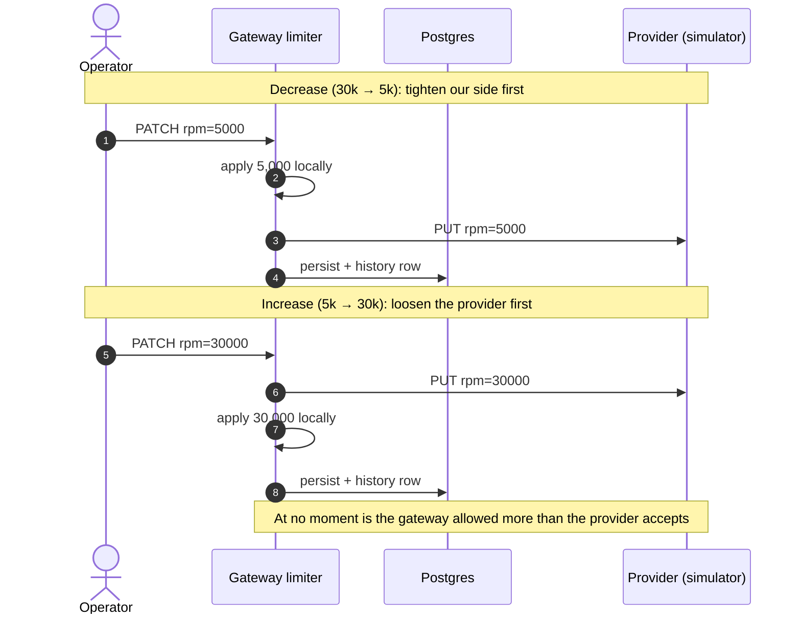

- **Safe ordering:** a decrease is applied to the gateway first and then to the simulator; an
  increase to the simulator first and then to the gateway. We are never above the provider's limit,
  even for a moment. With `SYNC_SIMULATOR_LIMITS=true` the gateway pushes changes to the simulator.
- **After a decrease** the last 60 s still hold traffic sent under the old limit, so nothing new is
  sent until usage is below the new limit. In Scenario 2 that is a ~50 s pause, then steady sending
  at 98% of 5,000 RPM.
- **After an increase** the new capacity is available immediately.

The simulator can also be changed directly: `PUT localhost:9000/sim/models/{name}` with any of its
fields.

### Main settings (`.env`)

| Variable | Default | Meaning |
|---|---|---|
| `TARGET_UTILIZATION` | `0.98` | Aim this far below each limit (headroom for clock and network jitter) |
| `LIMITER_BURST_FACTOR` | `1.0` | Max per-second share of the minute's limit (1.0 = perfectly smooth) |
| `MAX_ATTEMPTS` | `4` | Provider attempts per request (transient errors only) |
| `RETRY_BASE_DELAY_MS` / `RETRY_MAX_DELAY_MS` | `200` / `10000` | Retry backoff |
| `MAX_INFLIGHT_PER_MODEL` | `1000` | Concurrent provider calls per model |
| `PROVIDER_MAX_CONNECTIONS` | `512` | HTTP connection pool to the provider |
| `CALLBACK_MAX_ATTEMPTS` | `10` | Callback delivery attempts before `dead_lettered` |
| `CALLBACK_BASE_DELAY_MS` / `CALLBACK_MAX_DELAY_MS` | `1000` / `60000` | Callback backoff |
| `RECEIVER_FAIL_FIRST_N` | `2` | Test receiver rejects this many attempts per batch |
| `SYNC_SIMULATOR_LIMITS` | `true` | Push API limit changes to the simulator |
| `PUBLIC_BASE_URL` | `http://localhost:8000` | Used to build `results_url` in callbacks |

The full list, with database and Redis URLs, is in [`.env.example`](.env.example).

---

## Load generator

An **open-loop** generator: it sends on a fixed schedule whether or not the gateway keeps up, which
is the only way to offer more load than capacity. It runs as its own process, from the CLI or from
the **Load test** page (`POST /v1/runs`).

```bash
# 500 req/s for 2 minutes, 60/40 across two models, batches of 20
.venv/bin/python -m loadgen run --rate 500 --duration 120 \
    --models model-a=0.6,model-b=0.4 --batch-size 20 --tokens 1000

# or the Makefile shortcut
make loadtest RATE=500 DURATION=120
```

| Option | Meaning |
|---|---|
| `--rate` | requests per second offered |
| `--duration` | seconds of load |
| `--models` | model mix, e.g. `model-a=0.6,model-b=0.4` |
| `--batch-size` | `1` = single requests, `>1` = batches |
| `--tokens`, `--token-jitter` | approximate tokens per request |
| `--callback`, `--callback-fail-first-n` | embedded callback receiver for batches |
| `--warmup` | seconds excluded from the completion-rate figure |

Every run writes `results/<scenario>/<timestamp>/report.md`, `report.json` and `throughput.png`. It
reports submitted, completed, successful and failed requests; the achieved completion rate;
end-to-end **and** provider-call p50/p95/p99 latency; configured vs observed RPM/TPM per model over
time; and batch completion and callback timing. Runs are also stored in Postgres for the UI.

---

## Validation scenarios

Start the stack (`make stack`), then in another terminal:

```bash
make scenario3     # ~1 min
make scenario1     # ~8-10 min
make scenario2     # ~9-11 min
make scenarios     # all three, ~20 min
```

Each prints a PASS/FAIL table and writes a report under `results/`. The scenario definitions are in
[`scenarios/`](scenarios).

Every scenario is checked twice, by two independent implementations. The **gateway** checks its own
per-second data. The **simulator** keeps every request timestamp and measures any real 60-second
period exactly; a pass requires 0 provider 429s and 0 violations there too.

### Scenario 1 — reach the available provider capacity ✅ PASS

One model at 50,000 RPM / 100M TPM; 1,000-token requests offered at 60,000 RPM (20% above capacity)
for 6 minutes.

| Check | Measured |
|---|---|
| ≥ 90% of capacity after 1-minute warm-up | **48,217 completed/min = 96.4%** |
| No 60 s window over either limit | max in any real 60 s at the provider: **49,000** requests (limit 50,000), 49M tokens (limit 100M); **0** provider 429s |
| Every request accounted for | 360,000 sent = 360,000 completed + 0 waiting + 0 expired + 0 rejected |

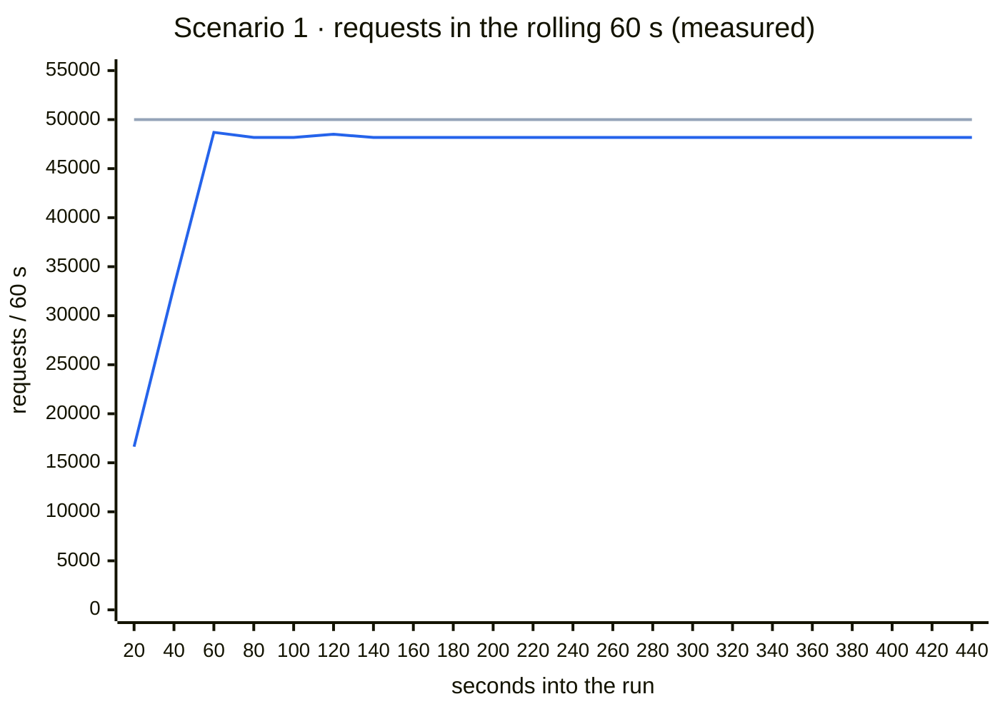

<sub>Grey = configured limit (50,000 RPM). Blue = observed requests in the trailing 60 s, computed
from the per-second data in `results/s1/20261015-034706/report.json`. It ramps up for the first
minute, then holds at ~48.2k: 98% of the limit minus the 61-bucket margin.</sub>

Provider-call latency p50/p95/p99: **203 / 457 / 639 ms**. End-to-end p50 is 41 s, which is
expected: demand is 20% above capacity, so requests queue. That is why both latencies are reported.

### Scenario 2 — different models and changing limits ✅ PASS

Model A at 30,000 RPM and model B at 20,000 RPM, both offered ~20% above their limit. A is cut to
5,000 RPM at 2:00 and restored to 30,000 at 4:30; B is never touched.

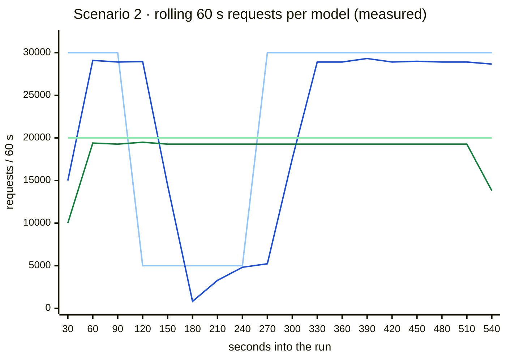

<sub>Light blue = model A's configured limit, dark blue = A observed. Light green = model B's limit,
dark green = B observed. Computed from `results/s2/20261015-035437/report.json`. A is cut to 5,000
at 120 s. The trailing window still holds traffic sent under the old limit, so A sends nothing
new until the window drains (the dip to 820), then holds just under 5,000. It climbs back after
the restore at 270 s. B stays flat throughout. The last point is the drain after the load
stops.</sub>

| Check | Measured |
|---|---|
| Each model within its current limits | A: max 29,400 in any 60 s · B: max 19,600 · **0** provider 429s for either |
| A adjusts to the cut without restart | **4,840/min** while cut (limit 5,000) |
| A recovers after the restore | **28,910** requests in the 60 s ending 75 s after the restore |
| B keeps processing while A is constrained | **19,205/min** (limit 20,000) |
| No restart | same gateway pid before and after |
| Accounting | 420,000 = 365,510 completed + 54,490 **expired** (A's backlog while cut: the defined overload behaviour) |

### Scenario 3 — asynchronous batch completion ✅ PASS

One batch of 10,000 requests across two models, 10% transient + 2% permanent provider failures,
and a callback endpoint that rejects the first two delivery attempts.

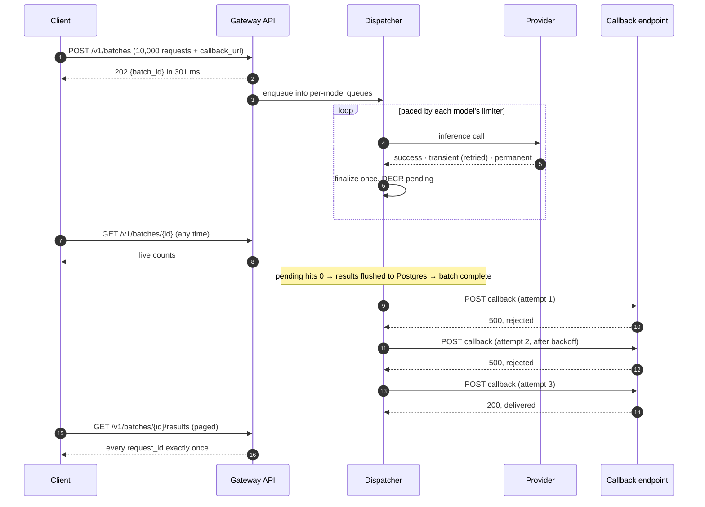

| Check | Measured |
|---|---|
| Acknowledgement within 1 s | **301 ms** |
| Callback only after every request is final | ✅ |
| Callback delivered after the destination recovers | ✅ attempt 3 (two rejections, then accepted) |
| Callback summary == `GET /v1/batches/{id}` | ✅ |
| Every request id exactly once in the results | ✅ 10,000 unique (9,786 succeeded, 214 failed) |

---

## Benchmarks

```bash
make bench           # required: 400k/s offered, 30M RPM across 10 processes
make bench-stretch   # stretch: 1.2M/s offered, 72M RPM across 10 processes
```

Stop the stack first so nothing else competes for CPU.

| Offered | Limit | Sustained completed/s | Latency p50 / p95 / p99 | Accounted | Violations |
|---|---|---|---|---|---|
| 400,000/s | 30M RPM | **400,030** | 196 / 449 / 632 ms | ✅ all 8.0M | 0 |
| 1,200,000/s | 72M RPM | **1,177,564** | 372 / 671 / 840 ms | ✅ all 24.0M | 0 |

**Scope (stated in every benchmark report):** this is an **in-process** benchmark. Each request
still goes through the real `SlidingWindowLimiter` and the real `ProviderSimulator` core, across 10
processes that each own 1/10 of the limit. There is **no HTTP, Redis or Postgres** on this path.
Provider latency is simulated with a 10 ms timer wheel, and the referee uses 100 ms buckets: exact
timestamps at 1M/s would mean ~60M entries per minute. A request counts only when it reaches a
final success or failure state. At 1.2M/s the machine is near CPU-bound (98% of offered; p50 rises
from 196 to 372 ms).

The HTTP path is measured separately by Scenario 1: one gateway process, ~800 dispatches/s.

> The benchmark's 20-second window includes the shards' startup. On a cold first run, with Python
> and matplotlib caches not yet built, that startup can cost several seconds and pull the
> "sustained" figure down; one such run measured 295,537/s while every full second ran at ~400k/s.
> Run it once to warm up before recording numbers.

---

## API reference

Interactive docs: http://localhost:8000/docs (gateway) and http://localhost:9000/docs (simulator).

### Gateway (:8000)

| Method | Endpoint | Purpose |
|---|---|---|
| POST | `/v1/requests` | Submit one request `{model, estimated_tokens, payload?, request_id?}` → `202` · `404` unknown model · `429` queue full · `422` invalid / larger than TPM |
| GET | `/v1/requests/{request_id}` | State, attempts, result or error, latency |
| POST | `/v1/batches` | `{requests: [...], callback_url?}` → `202 {batch_id, status_url}` |
| GET | `/v1/batches` | Recent batches |
| GET | `/v1/batches/{batch_id}` | Status, total, succeeded, failed, expired, rejected, pending, callback status, `results_url` |
| GET | `/v1/batches/{batch_id}/results?cursor=&limit=` | Final results, paged by request id (limit 1–5000) |
| GET | `/v1/batches/{batch_id}/callbacks` | Every callback delivery attempt |
| GET | `/v1/models` · `/v1/models/{model}` | Limits, effective (98%) limits, queue, in-flight, rolling 60 s usage |
| PATCH | `/v1/models/{model}/limits` | `{rpm?, tpm?}`: applied live (safe ordering), persisted, pushed to the simulator |
| GET | `/v1/models/{model}/limits/history` | Every limit change, old → new |
| GET | `/v1/stats` | Accounting with the `balanced` check, plus per-model queue / in-flight / limits |
| GET | `/v1/metrics/live` | Accounting + per-model live view |
| GET | `/v1/stream` | Server-Sent Events: one live snapshot per second |
| GET | `/v1/metrics/timeseries?since=&until=&model=` | Per-second, per-model rows + limit changes |
| GET | `/v1/metrics/latency?kind=end_to_end\|provider_call` | p50/p95/p99 |
| GET | `/metrics` | Prometheus text format |
| POST / GET | `/v1/runs` · `/v1/runs/{id}` · `POST /v1/runs/{id}/stop` | Start (one at a time), list, inspect, stop load-test runs |
| GET | `/healthz` | Health, with `pid`, `started_at`, `uptime_seconds` (no-restart proof) |

**Callback payload** (POSTed to `callback_url` with header `Idempotency-Key: <batch_id>`):

```json
{
  "batch_id": "bat_…", "status": "completed_with_failures",
  "total": 10000, "succeeded": 9786, "failed": 214, "expired": 0, "rejected": 0,
  "results_url": "http://localhost:8000/v1/batches/bat_…/results",
  "completed_at": "…", "delivery_attempt": 3
}
```

Results are linked rather than inlined: 10,000 results are too large for one callback.

### Provider simulator (:9000)

| Method | Endpoint | Purpose |
|---|---|---|
| POST | `/sim/inference` | One call → `200` · `400` permanent · `503` transient · `429` rate limited (`Retry-After`) · `404` unknown model |
| GET / PUT | `/sim/models` · `/sim/models/{name}` | Read / change limits, latency, error rates, `enforce_limits` |
| GET | `/sim/stats` | Per model: accepted, errors, 429s, **violations**, **max requests/tokens in any 60 s** |
| POST | `/sim/reset` | Clear counters (keeps settings) |

### Test callback receiver (:9100)

`POST /callbacks/receive` · `PUT /callbacks/config {fail_first_n}` · `GET /callbacks/received` ·
`POST /callbacks/reset`

---

## Design decisions and tradeoffs

### Why a sliding window: the trap in Scenario 1

A per-clock-minute counter looks fine minute by minute, but lets 2× the limit through across a
minute boundary:

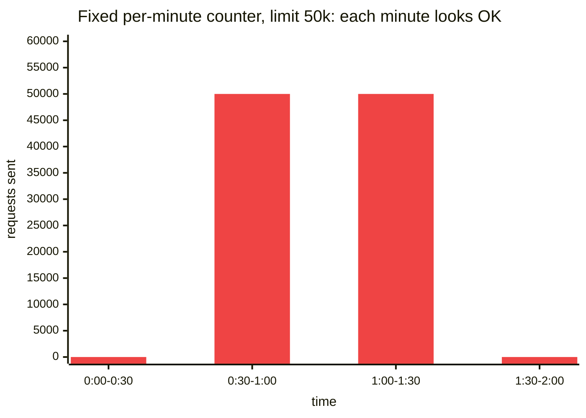

<sub>Minute 1 holds 50k and minute 2 holds 50k, yet the real 60 s period 0:30 → 1:30 holds **100k,
twice the limit**. The limiter counts the trailing 61 one-second buckets instead, so every real
60-second period is covered.</sub>


| Decision | Why | Tradeoff |
|---|---|---|
| **Sliding window of 61 one-second buckets**, not a fixed per-minute counter | The rule is that *no* 60-second period may exceed the limit. A fixed counter allows 2× at a minute boundary. Any period (t−60, t] can start part-way through the bucket from 60 s ago, so that whole bucket is counted too. A test proves it: switching to 60 buckets makes the randomized referee test fail. | Costs up to ~1.6% of capacity |
| **RPM and TPM checked together** | A request goes out only if both +1 request and +N tokens fit. With 1k-token requests RPM binds first; with large requests TPM does. | — |
| **98% target utilization + pacing in 100 ms slices** | Each second's share goes out in 10 steps, not one burst. Bursts queue in the HTTP pool and can reach the provider after a limit change. | ~2% of capacity left unused; expected ~96% vs the 90% pass bar |
| **One lane per model** (queue + limiter + scheduler + in-flight counter) | A throttled model can never block another (Scenario 2). | Per-model memory and a task each |
| **Retries go back through the queue and limiter** | A retry is a new provider call and must use capacity. Retries go to the front of the queue because they've already waited. | Retries compete with new work |
| **Bounded queues + max wait** | Defined overload behaviour: 429 backpressure when full, `EXPIRED` after `max_wait_seconds`. Memory can't grow without bound. | Under sustained overload some requests expire by design |
| **Safe ordering of limit changes** | Decrease: gateway first, then provider. Increase: provider first, then gateway. We are never above the provider for a moment. Found when the first Scenario 2 run produced 437 provider 429s. | — |
| **Redis for live state, Postgres for durable records** | At these rates a Postgres write per state change is impossible. Final results are buffered and bulk-inserted with `ON CONFLICT DO NOTHING`. | Two stores to run |
| **`request_id` is the primary key** | The database guarantees each id is stored exactly once. Clients may send their own id, kept as `client_request_id`. | — |
| **Batch completion is an atomic `DECR` reaching 0** | Each request is finalized exactly once, so "pending hit 0" happens exactly once: exactly one completion, exactly one callback flow. | — |
| **Results flushed before announcing completion** | The callback's `results_url` works the moment the client hears about it. | Slightly later callback |
| **Callback summary and `GET /v1/batches/{id}` read the same Redis hash** | They cannot disagree (a Scenario 3 check). | — |
| **At-least-once callbacks with `Idempotency-Key`** | A crash between sending and recording could resend; the header lets the receiver de-duplicate. Retries use a Redis sorted set with exponential backoff, then `dead_lettered`. | Receiver must de-duplicate |
| **Independent referee in the simulator** | The simulator keeps exact timestamps; the limiter uses buckets. Two different algorithms checking each other. | Memory per event (bucketed in the benchmark) |
| **aiohttp for provider calls** | At a 1,000 req/s target, httpx reached ~70 req/s at 76% CPU; aiohttp kept up at ~19% CPU. | httpx kept for low-volume callbacks |
| **Blocking Redis connection pool** | Under load the default pool errors past its limit; the blocking pool makes callers wait briefly. | Callers may wait briefly |
| **Limits from the database at startup** | API changes survive restarts and every change has a history row. | YAML only seeds new models |
| **Two latencies** | End-to-end (includes queueing when demand > capacity) and provider-call. Mixing them hides what's going on. | — |
| **TPM counted on `estimated_tokens`** | That's what the provider sees on the request, so both sides count the same thing. | Actual tokens are recorded but not reconciled into the limiter |
| **In-memory limiter per process** | Microsecond decisions on the hot path. Scaling gives each process a *share* of the limit (as the benchmark does). | A single gateway process is the HTTP-path ceiling |
| **Sharded in-process benchmark** | 300k–1M/s can't go through one Python HTTP process; each shard runs the real limiter and simulator per request. | Not an end-to-end HTTP number; stated in every report |

---

## Known limitations

- **Queues live in the gateway's memory.** If the process crashes, queued requests stay non-final
  in Redis and Postgres. Recovering them at startup, or a durable queue, is part of the scaling plan.
- **One gateway process.** The HTTP path tops out around 800–1,000 dispatches/s per process; higher
  rates need multiple processes, each owning a share of every model's limit.
- **Token estimates aren't reconciled.** The limiter counts `estimated_tokens`; if actual usage runs
  consistently higher, lower `TARGET_UTILIZATION` or add a per-model correction factor.
- **The benchmark is in-process** (no HTTP, Redis or Postgres), as described above.
- **Pinned frontend dependencies** carry `npm audit` advisories (mostly dev tooling).

---

## Scaling to 10B requests/min

> **Projection, not measured.** This section is a design plan.

10 billion requests/minute is ~167M requests/second, about 140× the measured stretch benchmark on
one machine. No single provider account carries that, so the design spreads across many providers,
accounts and regions, and across many machines on our side.

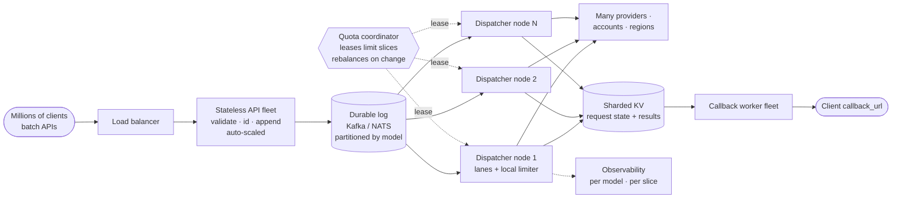

| Layer | Design |
|---|---|
| **Clients** | Batch APIs as the default path, so per-request HTTP overhead is paid once per batch |
| **Stateless API fleet** | Behind a load balancer, auto-scaled; validates, assigns ids and appends to a log; no in-memory queues |
| **Durable log** (Kafka / NATS JetStream) | Partitioned by model (and tenant); replaces the in-memory queues; replay after a crash fixes the current biggest limitation |
| **Dispatcher fleet** | Each node owns a set of partitions and runs the same lane + sliding-window limiter design locally, against its *slice* of the limit |
| **Quota coordinator** | Leases limit slices to dispatcher nodes and rebalances when nodes join or leave or when a provider limit changes. The safe-ordering rule extends to it: shrink leases before lowering, raise the provider before growing leases. |
| **Many providers / accounts / regions** | Each (provider, account, model) is its own limit; routing picks one with headroom |
| **Results store + callback service** | Sharded KV (e.g. Redis Cluster, Cassandra, ScyllaDB) for request state; a separate callback worker fleet consuming completion events |
| **Observability** | Per-model, per-slice dashboards and alerts on observed vs configured usage, and on any referee violation |

The building blocks are already proven here at single-machine scale: per-model isolation, a
conservative sliding window, per-process limit shares (the benchmark's 10 shards), and atomic batch
completion.

---

## Testing

```bash
make test     # 135 tests
make lint
```

Tests use a separate database (`inference_test`) and Redis db 15, so they never touch real data.
Database and Redis tests skip themselves if those services aren't running. Highlights:

- **Randomized referee test:** 10 simulated minutes of greedy traffic through the limiter, checked
  by the exact-timestamp referee. Switching the limiter to 60 buckets makes it fail.
- **Limit-change ordering:** we are never above the provider during a decrease or an increase.
- **Scenario-3 shape end to end:** ack, callback retries, summary == status, ids exactly once.
- **Migration drift:** the hand-written migrations must match the SQLAlchemy models.
- **Pure, unit-tested PASS/FAIL checks** for the load generator's reports.

Scenarios use the main `inference` database. Don't point tests and scenarios at the same database
at once: the tests truncate their tables.

---

## Project layout

```
backend/
  common/       settings, schemas, request state machine, model registry
  db/           SQLAlchemy tables, sessions, Redis client and key names, seed
  dispatcher/   limiter, per-model lanes and scheduler, provider client, Redis store, results writer
  callbacks/    batch completion + callback delivery with backoff
  simulator/    provider simulator: core (no I/O), exact referee, HTTP app
  receiver/     test callback endpoint
  gateway/      FastAPI app, runtime wiring, models / metrics / runs APIs
  metrics/      per-second per-model collector + Prometheus
  bench/        sharded in-process benchmark engine and runner
loadgen/        load generator CLI, scenario runner, checks, reports
scenarios/      s1.yaml, s2.yaml, s3.yaml
config/         models.yaml (gateway limits), simulator.yaml (simulated provider)
migrations/     Alembic migrations
scripts/        stack.py (start all services), smoke_batch.py (live Scenario 3 check)
frontend/       React + Vite + TypeScript + Tailwind + Recharts + Redux Toolkit dashboard
tests/          unit + integration tests
results/        run reports (report.md, report.json, throughput.png)
```

---

## AI usage

Built with Claude Code. The workflow: I designed the system and wrote a spec per commit (files,
design decisions, pass criteria). Claude Code implemented each spec, then ran the tests, lint and
the live checks. I reviewed and committed every step myself.

| Area | What AI did | What I decided or changed |
|---|---|---|
| Core model | Wrote settings, schemas, state enum, tests | The 8 states and allowed transitions; retries re-enter the limiter; the 4 accounting buckets |
| Storage | SQLAlchemy models, migrations, Redis client, seed | Redis for the hot path, Postgres for durable records; `request_id` as primary key; limit-history table |
| Limiter + simulator | Limiter, simulator, referee, tests | 61 buckets, verified by making the 60-bucket version fail; an independent exact referee; 98% utilization and smooth pacing; the "observe" mode |
| Gateway + batches | API, dispatcher, store, results writer, callbacks, tests | Overload behaviour (429, expiry); atomic batch completion; flush results before the callback; switched httpx → aiohttp after measuring it under load |
| Evidence | Limits/metrics/runs APIs, load generator, checks, benchmark, UI | The pass checks and the "limit in force per second" rule; diagnosed the first Scenario 2 failure (437 provider 429s) and fixed it with safe ordering + 100 ms pacing; split end-to-end vs provider-call latency; kept the benchmark's scope explicit |
